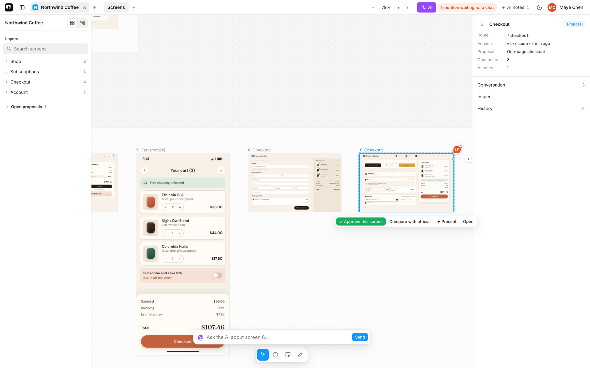

<h1 align="center">
  <br>
  Screenbook
</h1>

<p align="center"><b>One living canvas per product. AI draws the screens, people review them.</b></p>

<p align="center">
  <a href="#quickstart">Quickstart</a> ·
  <a href="#features">Features</a> ·
  <a href="#architecture">Architecture</a> ·
  <a href="#self-hosting">Self-hosting</a> ·
  <a href="#security">Security</a> ·
  <a href="#contributing">Contributing</a>
</p>

<p align="center"></p>

## Why

AI coding agents are good at drawing screens in HTML. What they are bad at is remembering them. A mockup made in a chat lives as long as the chat, the next person starts again from a blank page, and reviewers end up commenting on screenshots in a thread.

Screenbook gives every product one canvas that keeps all of its screens. The chat you already have open (Claude Code, or any MCP client) reads the canvas, draws new screens and changes old ones; every drawing becomes a version with its screenshot. People open the canvas in the browser, pin comments to the exact piece of a screen, write `@claude` to ask for a change, and approve. The next mission starts from what exists, not from zero.

- **Screens are made by AI.** Each one is plain HTML, versioned, with its screenshot.
- **Screens are reviewed by people.** Comments, mentions and approval live next to the drawing.
- **One canvas per product.** Sections, flows and the official version of every screen, in one place that outlives any chat.

## Features

| | |
|---|---|
| **Design canvas** | Pan and zoom, sections and pages, a layers panel, a command palette, a flow view that links screens by navigation, presentation mode, light and dark. |
| **Proposals and approval** | A change opens a proposal next to the official screen. Compare them with a slider, approve screen by screen, archive the options that lost. Every version stays in the history. |
| **Comments with `@claude`** | Comment on a piece of a screen, mention the agent, and the chat that is listening wakes up, changes the screen and answers in the thread. |
| **Direct editing** | Select an element in a screen and change its text, colors, spacing or layout in place, like in a design tool. Each edit is a new version. |
| **Built-in AI** | Ask for a change from the canvas itself. It runs Claude Code on the server with **each person's own Claude account** (they sign in once; credentials are encrypted at rest), so nobody shares a key. |
| **MCP server** | Twenty-odd tools for Claude Code and any MCP client: open a product, read and write screens, shared parts, screenshots, links, annotations, approval, public links. Every drawing comes back with its screenshot so the agent sees what it drew. |
| **Multiplayer** | Live cursors and selections of everyone on the canvas, and a marker showing where each agent is working right now. |
| **Product guide** | A short memory per product (visual rules, tone, what was approved and refused) that every request reads first. |
| **Public links** | Share one proposal with someone outside your organization for 30 days: they can read and comment, nothing else. |

## Quickstart

Requires Node 20+ and Chrome or Chromium (for screenshots).

```bash
npx -y github:arvoreeducacao/screenbook serve --store dir:./screens
npx -y github:arvoreeducacao/screenbook install --store http://127.0.0.1:4600 --viewer http://127.0.0.1:4600
claude "/screenbook draw the sign-up screen of my product"
```

1. `serve` starts the canvas at http://127.0.0.1:4600, storing everything as plain files in `./screens`.
2. `install` copies the skill into `.claude/skills/screenbook` and registers the MCP server in Claude Code (add `--scope user` for every project). Other MCP clients can run `screenbook mcp --store <store>` over stdio; the server sends the skill as its instructions.
3. Ask your chat for a screen. Open the canvas, comment with `@claude`, and keep the listener running so the chat answers:

```bash
npx -y github:arvoreeducacao/screenbook watch --store http://127.0.0.1:4600 --handle claude --follow
```

## Architecture

```
  Claude Code / MCP client ──┐                      ┌── people in the browser
     (screenbook mcp)        │   POST /api/rpc       │   (canvas, comments, approval,
                             ├──────────────────────►│    live cursors, built-in AI)
  screenbook watch ──────────┘                       │
                                         ┌───────────┴───────────┐
                                         │   screenbook serve    │  the only writer
                                         │  index + cache in RAM │  one change at a time
                                         └───────────┬───────────┘
                                                     │
                                  s3://bucket/prefix │ dir:./path
```

- **The server is the single writer.** The MCP server and the listener do not touch storage when the store is a server address: they call `POST /api/rpc`, signed with a Screenbook key, and the server applies one change at a time. Two chats drawing in the same proposal never overwrite each other.
- **Storage is plain files**, in the backend you choose: a Screenbook server (`https://…`, recommended), S3 (`s3://bucket/prefix`, credentials from the environment) or a local folder (`dir:./path`). A `github:owner/repo` store, which commits every action to a branch, still works but is legacy.
- **One store, many products.** A store holds one product or one folder per product. With folders the viewer lists the products at `/`, serves each at `/<product>/`, and every MCP tool takes a `product`.

```
project.json              name, sections, pages, shared head
head.html                 fonts and CSS variables wrapped around every screen
screens/<id>/meta.json    name, section, route, official version, history
screens/<id>/v3.html      every write is a new version
screens/<id>/v3.png       its screenshot
parts/<name>.html         pieces shared by screens, like a sidebar
proposals/<id>/proposal.json
flows.json                links between screens
comments/<screen>.jsonl   comments, replies and AI annotations
mentions/<handle>.jsonl   what the listener watches
shares/<token>.json       public links
```

### How a mention reaches the chat

1. Someone comments on a piece of a screen and writes `@claude`.
2. The server saves the comment and appends it to `mentions/claude.jsonl`.
3. `screenbook watch`, left running by the chat, sees a mention with no answer and prints it, which wakes the chat.
4. The chat changes the screen with `write_screen`, looks at the screenshot and answers with `reply_comment`. The answer marks the mention as handled.
5. With no chat listening, the mention waits; the next chat that opens the product sees it first.

## Self-hosting

The image bundles Chromium for screenshots and Claude Code for the built-in AI.

```bash
docker build -t screenbook .
docker run -p 4600:4600 \
  -e SCREENBOOK_STORE=s3://my-bucket/screens \
  -e SCREENBOOK_GITHUB_CLIENT_ID=… -e SCREENBOOK_GITHUB_CLIENT_SECRET=… \
  -e SCREENBOOK_SESSION_SECRET=$(openssl rand -hex 32) \
  -e SCREENBOOK_ACCESS_REPO=my-org/screens \
  -e SCREENBOOK_PUBLIC_URL=https://screens.example.com \
  screenbook
```

`screenbook create-github-app --org <org> --url <public url>` creates one GitHub App that handles both the login and, for a GitHub store, the writes. A Kubernetes example (Deployment, Service, Ingress, IRSA service account for S3) is in [`deploy/kubernetes.yaml`](deploy/kubernetes.yaml).

| Variable | What it does |
|---|---|
| `SCREENBOOK_STORE` | Where the screens live (`dir:`, `s3://`, `https://`). Same as `--store`. |
| `SCREENBOOK_GITHUB_CLIENT_ID`, `SCREENBOOK_GITHUB_CLIENT_SECRET`, `SCREENBOOK_SESSION_SECRET` | Turn on GitHub login. Without them the server has no login and binds to `127.0.0.1`. |
| `SCREENBOOK_ACCESS_REPO` | `owner/repo`: only people who can read this repository get in. |
| `SCREENBOOK_PUBLIC_URL` | The public address, for login callbacks and links. |
| `SCREENBOOK_GITHUB_APP_ID`, `SCREENBOOK_GITHUB_APP_PRIVATE_KEY` | GitHub App credentials, for a GitHub store. |
| `SCREENBOOK_AI` | `off` disables the built-in AI. |
| `SCREENBOOK_AI_MODEL`, `SCREENBOOK_AI_SLOTS` | Model for the built-in AI (default `opus`) and how many runs at once (default 2). |
| `SCREENBOOK_CHROME` | Path to Chrome or Chromium, if it is not in a standard place. |
| `SCREENBOOK_HANDLE`, `SCREENBOOK_VIEWER`, `SCREENBOOK_TOKEN` | Client side: the agent's handle, the canvas address, and a key that overrides the saved one. |

The interface follows the browser's language: English by default, Portuguese (pt-BR) when the browser asks for it. Translations live in `viewer/i18n-*.js`; adding a language is one dictionary file.

## Security

- **No login, no exposure.** Without the GitHub login variables, `serve` binds to `127.0.0.1` only. Do not put it behind a public address like that.
- **Access follows a GitHub repository.** With login on, only accounts that can read `SCREENBOOK_ACCESS_REPO` (or the store's repository) get in. Agents authenticate with a Screenbook key: the first call from a chat opens the browser once (`screenbook login --store https://…` does it by hand), the person confirms on a `/connect` page, and the key is saved in `~/.config/screenbook/credentials.json` on that computer only. Keys last 180 days, never touch GitHub, and `POST /api/keys/revoke` revokes all of a person's keys.
- **Screens are sandboxed.** Screen HTML is served with `Content-Security-Policy: sandbox`, so a drawing cannot call the viewer's API or read its cookies. Writes accept JSON only.
- **Each person's Claude account stays theirs.** The built-in AI keeps each person's Claude credentials encrypted with AES-256-GCM under a key derived from `SCREENBOOK_SESSION_SECRET`, runs every request in that person's own home directory, and gives the run a short-lived token scoped to that person.
- **Public links are narrow.** A link opens one proposal for reading and commenting, expires in 30 days, can be revoked, and its comments never wake an agent.

Found a vulnerability? Please do not open a public issue: use GitHub's [private vulnerability reporting](../../security/advisories/new).

## Contributing

```bash
git clone https://github.com/arvoreeducacao/screenbook && cd screenbook
npm install
npm test
npm run serve -- --store dir:./tmp-screens
```

Plain JavaScript modules on Node 20+, no build step, tests with `node:test`. The viewer is vanilla JS and CSS in `viewer/`; the server, store and MCP are in `src/`. Issues and pull requests are welcome; keep pull requests small, with a test for the behavior they change, and new UI copy in English with its pt-BR entry in `viewer/i18n-pt.js`.

## License

[MIT](LICENSE)
